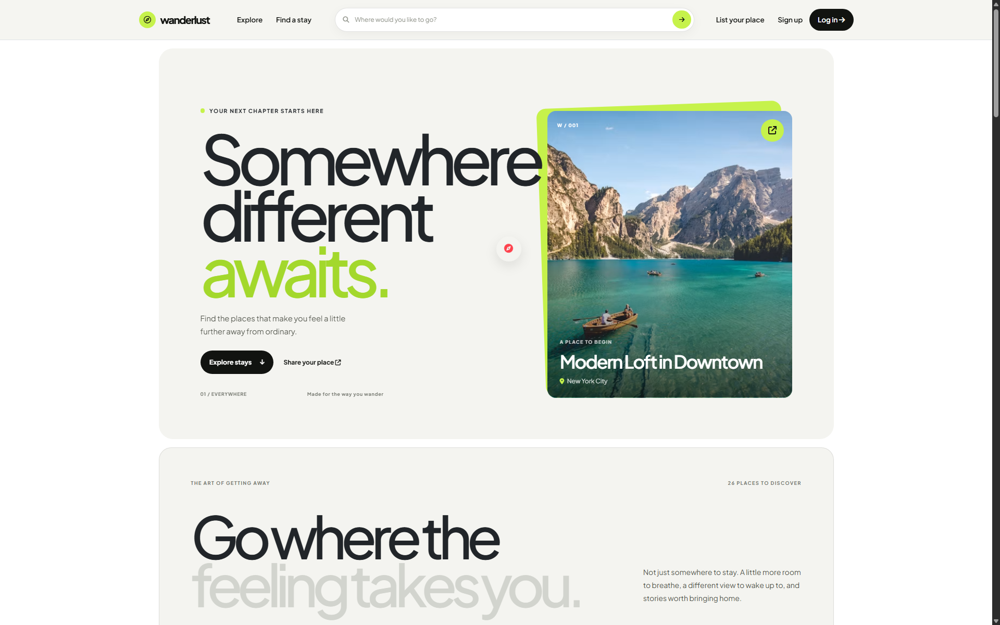

# Wanderlust

Wanderlust is a server-rendered travel-stay discovery and listing application. Visitors can browse and search for places to stay, view listing details and locations, and read reviews. Registered users can publish and manage their own listings, add reviews, and manage reviews they wrote.

The application is built with Node.js, Express, EJS, and MongoDB. Express routes process browser form submissions and render HTML pages; this project does **not** currently expose a JSON REST API.

## Website screenshot



## Features

- Browse listings in an image-led, responsive discovery page.
- Search by listing title or location. Search is case-insensitive, accepts up to 100 characters, and supports multiple words.
- View a listing's image, description, price, location, owner, reviews, and Mapbox map.
- Create a listing with an uploaded image, title, description, price, location, and country.
- Register, log in, and log out using Passport local authentication.
- Edit or delete listings as their owner.
- Submit reviews and delete reviews as their author.
- Display the UI's optional 18% tax calculation.
- Use responsive navigation, dismissible notifications, delete-confirmation dialogs, and reduced-motion-aware animations.

## Technology and integrations

| Area | Technology |
| --- | --- |
| Runtime | Node.js 16.13.0 |
| HTTP server and routing | Express 4 |
| Templates | EJS and ejs-mate |
| Database and ODM | MongoDB and Mongoose |
| Authentication | Passport, passport-local, passport-local-mongoose |
| Request validation | Joi |
| Multipart image uploads | Multer and multer-storage-cloudinary |
| Image hosting | Cloudinary |
| Geocoding and maps | Mapbox |
| UI | Bootstrap 5, Font Awesome, custom CSS and browser JavaScript |

## Run locally

### Prerequisites

- Node.js 16.13.0 and npm.
- MongoDB running locally.
- A Cloudinary account and credentials to upload listing images.
- A Mapbox access token for listing geocoding and maps.

### Install and configure

1. Clone this repository and enter its directory:

   ```bash
   git clone <repository-url>
   cd wanderlust
   ```

2. Start MongoDB. The current application connects to:

   ```text
   mongodb://127.0.0.1:27017/wanderlust
   ```

   This connection string is currently defined directly in `app.js`.

3. Create a `.env` file in the repository root:

   ```dotenv
   CLOUD_NAME=your_cloudinary_cloud_name
   CLOUD_API_KEY=your_cloudinary_api_key
   CLOUD_API_SECRET=your_cloudinary_api_secret
   MAP_TOKEN=your_mapbox_access_token
   ```

   `.env` is ignored by Git. Never commit real credentials.

4. Install dependencies and launch the server:

   ```bash
   npm install
   node app.js
   ```

5. Visit **http://localhost:8080/listings**.

The project currently uses port `8080`; it has no `npm start` script. The root URL `/` is not a landing-page route; open `/listings`.

### External service behavior

- **Cloudinary** stores images submitted with create/edit listing forms. Valid Cloudinary configuration is required for uploads.
- **Mapbox geocoding** is used when a listing is created. The map on the listing detail page also needs a valid `MAP_TOKEN`.
- Without a usable Mapbox token or listing coordinates, the listing detail page displays a map-unavailable message instead of trying to initialize the map.
- Map popup listing titles are inserted as text rather than interpreted as HTML.

## All application routes

These are browser-facing Express routes. Page routes render EJS; create/update/delete/auth actions generally respond with redirects and flash notifications rather than JSON. Requests that fail validation or reach the error handler render the application error page.

### Listings

| Method | Path | Purpose and behavior | Access |
| --- | --- | --- | --- |
| `GET` | `/listings` | Render all listings. Optional `?q=beach` searches title and location. | Public |
| `POST` | `/listings` | Upload an image, geocode its location, and create a listing; redirects to `/listings`. | Logged in |
| `GET` | `/listings/new` | Render the new-listing form. | Logged in |
| `GET` | `/listings/:id` | Render listing details, reviews, and the location map. A missing listing flashes a message and redirects to `/listings`. | Public |
| `GET` | `/listings/:id/edit` | Render the edit form. | Listing owner |
| `PUT` | `/listings/:id` | Update listing fields and optionally replace its image; redirects to `/listings/:id`. | Listing owner |
| `DELETE` | `/listings/:id` | Delete a listing and its associated reviews; redirects to `/listings`. | Listing owner |

The `:id` parameter is a MongoDB listing ObjectId. HTML forms send listing fields using `listing[...]` names. Create and edit forms use `multipart/form-data`; the uploaded file field is `listing[image]`.

Create/update form fields:

| Field | Type | Notes |
| --- | --- | --- |
| `listing[title]` | Text | Listing title |
| `listing[description]` | Text | Description |
| `listing[price]` | Number | Price per night; Joi requires a value of at least zero |
| `listing[location]` | Text | Used for the display location and Mapbox geocoding |
| `listing[country]` | Text | Country |
| `listing[image]` | File | Image uploaded to Cloudinary; required by the create form, optional on edit |

Example search URL:

```text
GET /listings?q=Modern%20York
```

Search terms are case-insensitive. For multi-word searches, each word must match either the title or the location; different words may match different fields.

### Reviews

Reviews are nested under their listing. `:id` is the listing ObjectId and `:reviewId` is the review ObjectId.

| Method | Path | Purpose and behavior | Access |
| --- | --- | --- | --- |
| `POST` | `/listings/:id/reviews` | Create a review for the listing and redirect to `/listings/:id`. | Logged in |
| `DELETE` | `/listings/:id/reviews/:reviewId` | Remove the review from the listing and redirect to `/listings/:id`. | Review author |

The review form sends `review[rating]` (1–5) and `review[comment]` (text). The current route records the signed-in user as the author. Review Joi validation is defined in `schema.js`, but the review routes do not currently call that validation middleware.

### Accounts and authentication

| Method | Path | Purpose and behavior | Access |
| --- | --- | --- | --- |
| `GET` | `/signup` | Render the account registration form. | Public |
| `POST` | `/signup` | Register with `username`, `email`, and `password`, then log in and redirect to `/listings`. | Public |
| `GET` | `/login` | Render the login form. | Public |
| `POST` | `/login` | Authenticate using `username` and `password`; on success redirect to the saved destination or `/listings`. | Public |
| `GET` | `/logout` | End the current session when available and redirect to `/listings`. | Public |

### Development/demo route

| Method | Path | Purpose |
| --- | --- | --- |
| `GET` | `/demouser` | Attempts to register and return a hard-coded demo user. This is an application route, not a production API; it can fail if the demo username already exists and should be disabled or protected before deployment. |

### Other behavior

- Unknown paths are handled by the catch-all route and render a not-found error page.
- `/` has no dedicated landing-page handler; it is handled like any other unknown path.
- Listing and review mutations use `method-override`, so HTML forms can submit `PUT` and `DELETE` using `_method`.
- Authentication and authorization are enforced by route middleware. Owners can modify their listings; only a review's author can delete that review.

## Request flow and project structure

1. `app.js` connects to MongoDB, configures EJS/layouts, static assets, sessions, flash messages, and Passport.
2. The route modules map HTTP methods/paths to authentication checks, upload processing, validation, and controller functions.
3. Controllers read submitted form data, use Mongoose models and external services where needed, then render an EJS page or redirect with a flash message.
4. Mongoose models define persisted users, listings, and reviews. Listing deletion also removes associated review documents.
5. Shared EJS includes render the navigation, notifications, and footer; the shared layout loads Bootstrap and client-side scripts.

```text
.
├── app.js                 # Express setup, MongoDB connection, middleware, route mounting
├── cloudConfig.js         # Cloudinary client and Multer storage
├── controllers/           # Listing, review, and user handlers
├── docs/screenshots/       # README website screenshot
├── init/                   # Optional sample data initializer
├── middleware.js           # Login, listing-owner, and review-author checks
├── models/                 # Mongoose User, Listing, and Review models
├── public/
│   ├── css/                # Application and rating styles
│   └── js/                 # Form validation, reveal motion, notifications, map dialogs
├── routes/                 # Listing, review, and user routes
├── schema.js               # Joi listing and review schemas
├── utils/                  # Async route wrapper and Express error class
└── views/
    ├── error.ejs            # Shared error page
    ├── includes/            # Navbar, flash notifications, and footer
    ├── layouts/             # Shared page layout
    ├── listings/            # Browse, detail, create, and edit pages
    └── users/               # Signup and login pages
```

## Database models

- **User:** email plus the username/password fields and authentication methods added by `passport-local-mongoose`.
- **Listing:** title, description, image URL and filename, price, location, country, owner, GeoJSON coordinates, and references to reviews.
- **Review:** comment, rating, creation date, and author.

The database name is `wanderlust`. The current `init/index.js` data initializer creates a demo user and sample listings, geocoding each sample location.

## Optional sample data

```bash
node init/index.js
```

> **Destructive:** the initializer deletes all users and listings in the configured database before inserting sample data. Do not run it against a database containing data you need. It also needs a working Mapbox token.

## Development and troubleshooting

- **MongoDB connection error:** make sure MongoDB is running on `127.0.0.1:27017`.
- **Image upload fails:** check the Cloudinary credentials and account configuration in `.env`.
- **Geocoding fails on listing creation:** check `MAP_TOKEN` and the submitted location.
- **Map is unavailable on a detail page:** check `MAP_TOKEN`, listing coordinates, and browser connectivity to Mapbox.
- **Port `8080` is in use:** stop the process using the port before launching the app.
- **Tests:** `npm test` is currently a placeholder and exits with “Error: no test specified”; no automated test suite is configured yet.
- **Server logs:** the app logs a database connection result and listens on port `8080`.

## Production checklist

This repository is configured for local development. Before production use:

- Read MongoDB URL, port, and session secret from environment variables; use a unique, strong session secret.
- Use a production session store, HTTPS, and secure cookie settings.
- Disable or protect `/demouser`, and remove hard-coded demo credentials.
- Enforce request validation on every mutation route, including reviews; restrict upload size and file types.
- Keep Cloudinary and Mapbox credentials private; restrict public Mapbox tokens by allowed origin.
- Add automated tests and production logging/monitoring.
